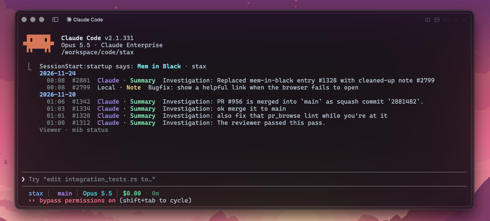
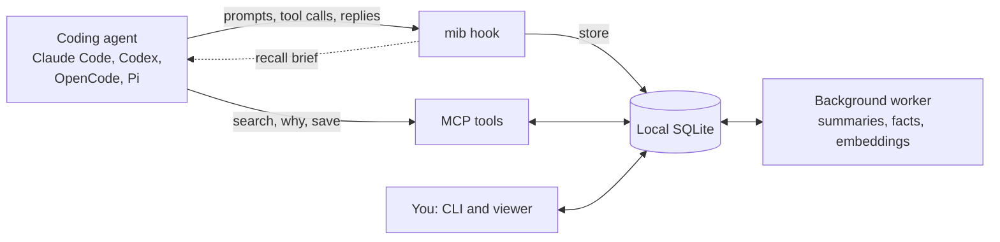

<div align="center">
  <h1>Mem in Black</h1>

  <p><strong>We remember so your agents don't have to.</strong></p>

  <p>
    <a href="https://github.com/cesarferreira/mem-in-black/actions/workflows/rust-tests.yml"></a>
    <a href="https://crates.io/crates/mem-in-black"></a>
    <a href="https://crates.io/crates/mem-in-black"></a>
    <a href="LICENSE"></a>
  </p>
  
  <p>
    <a href="#install">Install</a>
    &nbsp;·&nbsp;
    <a href="#features">Features</a>
    &nbsp;·&nbsp;
    <a href="#how-it-works">How it works</a>
    &nbsp;·&nbsp;
    <a href="#configuration">Configuration</a>
  </p>
</div>

---

Shared, local memory for coding agents. Start a task in Claude Code, continue
it in Codex, switch back. When a prompt matches earlier work, `mib` adds a short
brief with the outcome, checks, decisions and next step.

Everything runs on your machine: no account, no telemetry. By default, Claude
Haiku writes summaries through your Claude Code login (`mib summaries disable`
keeps that local too).

| Cost | |
| --- | --- |
| Context per recall | ~300 tokens on average |
| Time per prompt | ~30 ms keywords only, ~130 ms with semantic search |
| Memory | ~7 MB. With semantic search: 277 MB in use, 17 MB after 30 idle min |
| CPU | 0% at rest. At most 2 low-priority cores while embedding |
| Disk | 13 MB binary, 436 MB optional model, ~3 KB per record for vectors |

## Install

Linux (x86_64, ARM64) or Apple silicon Mac:

```bash
curl -fsSL https://raw.githubusercontent.com/cesarferreira/mem-in-black/main/install.sh | sh
mib install
```

The script verifies SHA-256 checksums and installs to `~/.local/bin`. Set
`MIB_INSTALL_DIR` for another folder or `MIB_VERSION=v0.1.1` for a specific
release.

With Rust 1.99+:

```bash
cargo install mem-in-black --locked   # or: cargo install --path . --locked
mib install
```

`mib install` configures every supported agent it finds and keeps your existing
hooks and MCP servers. Restart your agents afterwards. Codex asks you to trust
the hooks once.

> [!TIP]
> Upgrading? Run `mib stop` first to stop the old worker.

| Agent | Capture | MCP | Configured |
| --- | --- | --- | --- |
| Claude Code | ✓ | ✓ | Always |
| Codex | ✓ | ✓ | Always |
| T3 Code (Codex, Claude Code) | ✓ | ✓ | When set up, or `--host t3code` (`T3CODE_HOME` for a custom location) |
| OpenCode | ✓ | ✓ | 2.2.4+, or 1.18.29+ with a running V1 server |
| Pi | ✓ | ✓ | When installed. `--host pi` adds a startup preview |
| Oh My Pi | ✓ | ✓ | When installed, or `--host omp` (`OMP_PROFILE=work` for a profile) |
| Any MCP client | | ✓ | Register the stdio command `mib mcp` |

## Features

Work as usual. `mib` stays quiet until it has something relevant.

- **Recall.** A prompt that matches earlier work in the project gets a brief with the outcome, checks, decisions and next step. If that work came from an older revision, the brief says which of its files changed since.
- **Recall before actions.** Before an edit, the agent sees up to two earlier decisions, errors or failed checks on that file. Before a check, it sees the last time that command failed. Each summary shows once per session, at most five times per session. `MIB_ACTION_RECALL=0` turns it off.
- **Dead ends.** Summaries record approaches that were abandoned, reverted by a later commit, or rejected by your next prompt ("that didn't work"). Edits recall these first.
- **Project facts.** Every 20 summaries, the worker condenses repeated episodes into durable notes: the check command that keeps passing, a recurring error and its fix, rejected attempts on a file, and (with model summaries) conventions cited by two or more summaries. Forgetting a summary deletes the facts built on it. See them with `mib knowledge`. `MIB_CONSOLIDATE=0` turns it off.
- **Handoff.** In the same worktree and branch, ask another agent to "continue the task started in Claude Code", and back again.
- **Why.** `mib why src/foo.rs:42` blames the line and shows the agent turn behind it: request, decision, checks and commit. `mib why src/foo.rs` lists the file's last 10 turns.
- **Startup preview.** New sessions show the latest summaries for the worktree. `MIB_STARTUP_PREVIEW=0` hides it.
- **Privacy.** A turn containing `<private>…</private>` is not captured.
- **MCP tools.** `search` (`memories_only: true` for decisions and completed work), `timeline`, `get_observations`, `why`, `save_memory` (`replaces` corrects old records) and `forget`.

Recall at the point of action needs Claude Code 2.1.9+ or Codex 0.170+. On
OpenCode and Pi, the brief is appended to the tool result as a separate,
clearly labelled part.

**Captured:** prompts, replies, shell commands with trimmed output, edited and
read paths, search patterns and short web excerpts. **Never stored:** file
contents, MCP tool results, terminal escape codes and lines that look like
credentials.

## How it works

Each agent event runs `mib hook`, which stores the event locally and can send a
short recall brief back to the agent. A background worker turns finished turns
into summaries and project facts. Agents look up more through MCP, and you use
the CLI and viewer.



Each summary holds the request, outcome, files changed, commits, checks and
their result, errors, decisions, any abandoned approach, and the next step.
Files, commits, checks and errors always come from tool records, not a model.

Prompt recall favours summaries the agent went on to use (opened a file or
named a commit from them) and skips ones it ignored in three sessions.
`MIB_ADAPTIVE_RANKING=0` turns that off.

## Commands

| Command | What it does |
| --- | --- |
| `mib open` | Open the live viewer: memories, source evidence, activity and recent recalls |
| `mib search "query"` | Search memory (`--workspace .` for one worktree) |
| `mib why <file>[:<line>]` | The request, decision and checks behind a line or file (`--json`) |
| `mib knowledge` | Project facts and the summaries behind them (`--json`) |
| `mib stats` | Usage, recall usefulness and an upper-bound estimate of tokens saved (`--json`) |
| `mib status` | Worker state, database path and viewer URL |
| `mib preview` | Recent activity for this worktree |
| `mib forget <id>…` | Delete records and the summaries built from them |
| `mib export` | All records as JSON lines |
| `mib stop` / `serve` | Stop the worker, or run it in the foreground |

## Semantic search

Finds *"reconnect attempts give up early"* in a record about a retry counter.

```bash
mib embeddings enable     # one-time 436 MB download, verified by SHA-256
mib embeddings status
mib embeddings disable    # back to keywords only
```

The model runs locally on the CPU and unloads after 30 idle minutes. Search
uses keywords until existing records are embedded. Automatic recall only uses a
semantic match above a calibrated similarity floor.

| Model (`--model`) | Download | MRR, titles | MRR, facts |
| --- | --- | --- | --- |
| Keywords only | none | 0.753 | 0.452 |
| `minilm` | 91 MB | 0.727 | 0.447 |
| `bge-small` | 134 MB | 0.765 | 0.465 |
| `bge-base` | 439 MB | 0.775 | 0.483 |
| **`arctic-m` (default)** | 436 MB | **0.779** | **0.485** |

Scores from `mib eval` on 2,577 real coding-session observations. 1.0 means the
right record always ranks first.

<a id="model-summaries"></a>
## Summaries

By default, Claude Haiku writes each summary's title, outcome, decision and
next step via `claude -p --model haiku`, in the background with hooks, tools and
MCP off. It gets the request, the extracted facts and the final reply. Private
turns are never sent. On failure or after the 60 s timeout, the turn gets a
local summary and the worker stays local for 10 minutes.

```bash
mib summaries status
mib summaries disable                        # local summaries only
mib summaries enable --model sonnet --timeout 30
mib summaries enable --provider openai \
  --endpoint https://gateway.example/v1/chat/completions \
  --model bifrost/haiku5.5 --api-key-env GATEWAY_KEY
```

Settings live in `summaries.json` in the data directory. `MIB_SUMMARIES=off`
disables model summaries for one process.

## Configuration

| Setting | Effect |
| --- | --- |
| `MIB_DATA_DIR` or `--data-dir` | Data directory. Default `~/.local/share/mem-in-black` |
| `database_path` in `~/.config/mem-in-black/config.toml` | Database location. Run `mib stop` first |
| `MIB_MODEL_IDLE_SECS` | Seconds before an idle model unloads. Default 1800 |
| `RAYON_NUM_THREADS` | Threads for semantic search. Default 2 |
| `MIB_STARTUP_PREVIEW=0` | Hide the startup preview. `NO_COLOR=1` for plain text |
| `MIB_NO_AUTOSTART=1` | Keep the worker stopped. Hooks still record |
| `MIB_DEBUG=1` | Print hook errors and recall decisions |
| `MIB_ACTION_RECALL=0` | Turn off recall before edits and checks |
| `MIB_ADAPTIVE_RANKING=0` | Rank recall without past use |
| `MIB_CONSOLIDATE=0` | Turn off project facts |

The database uses WAL journaling on local disks and rollback journaling on NFS
and SMB mounts.

## License

MIT. See `LICENSE`.
